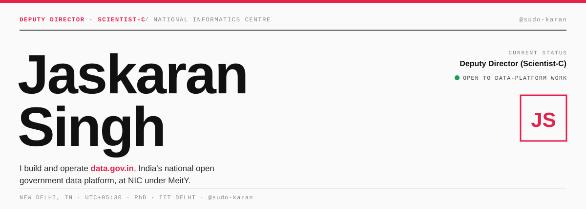

<!-- Masthead: name lives in hero SVGs (light + dark), with full alt text. -->
<picture>
  <source media="(prefers-color-scheme: dark)" srcset="hero-dark.svg">
  
</picture>

## `01` · About

I lead a team at the National Informatics Centre that builds and runs **data.gov.in**, the Bharat Data Platform. Day to day that means the rebuild into microservices, a DCAT-3 metadata model, an Apache APISIX gateway in front of the APIs, and Airflow ingestion running on Kubernetes behind a single Elasticsearch index.

I also advise government departments and state partners on how they publish and structure their data. In 2025 I started a part-time PhD in Computer Science at IIT Delhi, working on forest-biodiversity monitoring from Sentinel-1 and Sentinel-2 imagery with Prof. Aaditeshwar Seth.

Most of what I build is backend data infrastructure. The side projects tend to be small, offline tools I wanted for myself.

---

## `02` · Selected work

| # | Repository | What it does | Stack |
|:--|:--|:--|:--|
| **R-01** | [**rag_chatbot**](https://github.com/sudo-karan/rag_chatbot) | Offline retrieval-augmented assistant for data.gov.in. Runs a local Ollama model with sentence-transformers and ChromaDB, served over REST with streaming responses. | `Ollama` `ChromaDB` `REST` |
| **R-02** | [**phd-code**](https://github.com/sudo-karan/phd-code) | Geospatial ML on Google Earth Engine, fusing Sentinel-2, Sentinel-1, canopy and terrain layers for biodiversity monitoring. | `Earth Engine` `Sentinel-1/2` `Python` |
| **R-03** | [**boyle-bingo**](https://github.com/sudo-karan/boyle-bingo) | Private multiplayer prediction-bingo PWA. Rules are enforced with Postgres row-level security, with realtime sync and a live leaderboard. | `React` `TypeScript` `Supabase` |
| **R-04** | [**pdf-to-markdown**](https://github.com/sudo-karan/pdf-to-markdown) | Converts PDFs to Markdown entirely in the browser with PDF.js, keeping images and captions in place. | `PDF.js` `JavaScript` |
| **R-05** | [**claude-usage**](https://github.com/sudo-karan/claude-usage) | Android app that tracks Claude usage limits, with a home-screen widget. Built with Kotlin and Jetpack Compose. | `Kotlin` `Compose` |
| **R-06** | [**goal_tracker**](https://github.com/sudo-karan/goal_tracker) | Offline Android goal tracker with reminders and a home-screen widget, storing everything locally with Room. | `Kotlin` `Room` |

---

## `03` · Stack

**`A` · Data platform**
`Python` · `SQL` · `Apache Airflow` · `Elasticsearch` · `MySQL` · `FastAPI` · `Drupal` · `PHP` · `REST` · `DCAT`

**`B` · Infrastructure**
`Kubernetes` · `Apache APISIX` · `Microservices` · `DR / Backup` · `Git`

**`C` · AI / ML**
`Machine learning` · `CNNs & GANs` · `LLMs & RAG` · `Clustering`

**`D` · Geospatial**
`Google Earth Engine` · `Sentinel-1 / 2` · `Remote sensing` · `SNIC superpixels` · `k-means`

**`E` · Languages**
`Java` · `Kotlin` · `TypeScript` · `JavaScript` · `C`

---

## `04` · Record


<br>

<picture>
  <source media="(prefers-color-scheme: dark)" srcset="https://raw.githubusercontent.com/sudo-karan/sudo-karan/output/github-snake-dark.svg">
  
</picture>

---

## `05` · Timeline

| Period | Role & notes |
|:--|:--|
| **`2026 — now`** | **Deputy Director (Scientist-C)** · NIC, MeitY<br>Promoted from Assistant Director in Aug 2026. Lead the team rebuilding data.gov.in into microservices, with DCAT-3 metadata, an APISIX gateway and disaster-recovery work. |
| **`2025 — now`** | **PhD, Computer Science** · IIT Delhi<br>Part-time, with Prof. Aaditeshwar Seth. Monitoring forest biodiversity from satellite data, collaborating with the Foundation for Ecological Security. |
| **`2022 — 2026`** | **Assistant Director (Scientist-B)** · NIC<br>Joined NIC in Mar 2022. Built ingestion pipelines on Airflow and Kubernetes, a FastAPI PII-detection service and a unified Elasticsearch catalog. |
| **`2021 — 2022`** | **Data Scientist** · McKinsey & Company<br>Operations Digital Assets. Earlier, a McKinsey intern on document layout-extraction. |
| **`2019 — 2021`** | **M.Tech, Computer Science** · PEC Chandigarh<br>CGPA 9.60/10. B.Tech in Computer Science from Punjabi University Patiala before that (2015–19, 8.21/10). |

**Certifications** — Azure Data Fundamentals (Microsoft) · Machine Learning with Python and Cloud Core (IBM) · data courses (University of Michigan, Coursera)
**Languages** — Punjabi (native) · Hindi (native) · English (professional working)

---

## `06` · Contact

[](https://github.com/sudo-karan/sudo-karan/blob/master/Jaskaran_Singh_Resume.pdf)
[](https://karan98.in)
[](https://www.linkedin.com/in/karan98)
[](https://github.com/sudo-karan)
[](mailto:jaskaran.pta@gmail.com)

<br>


```
sudo-karan · New Delhi, India · UTC+05:30
```
