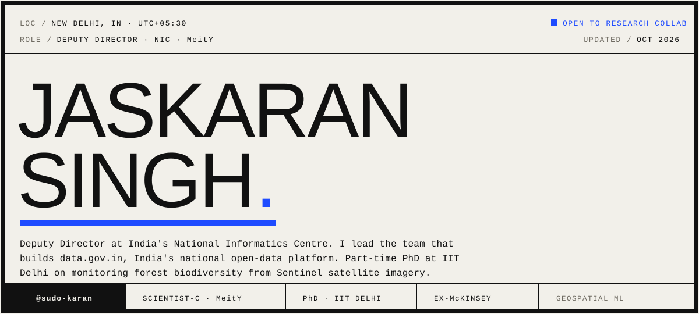

<!-- Masthead: the name lives in hero.svg (self-hosted, with full alt text). -->


## `01` ABOUT

I build and scale public data infrastructure at NIC, part of India's Ministry of Electronics and IT. My team designs and runs **data.gov.in**, the country's open government data platform, and I advise government departments and state partners on how they publish and structure their data.

Right now I'm rebuilding that platform: breaking it into microservices, moving to DCAT-3 metadata, putting an Apache APISIX gateway in front of the APIs, and running the ingestion pipelines on Airflow over Kubernetes. On the side I write small tools, mostly offline ones, and Android apps I actually use.

My PhD, at IIT Delhi with Prof. Aaditeshwar Seth, looks at measuring forest biodiversity from Sentinel-1 and Sentinel-2 imagery, in collaboration with the Foundation for Ecological Security.

---

## `02` BY THE NUMBERS


---

## `03` CURRENT WORK — data.gov.in

### Building the Bharat Data Platform
**National Informatics Centre · MeitY, Government of India**

- Leading the rebuild: microservice decomposition, DCAT-3 metadata, an Apache APISIX API gateway, and disaster-recovery / backup.
- Apache Airflow ingestion pipelines running on Kubernetes.
- Catalog and API clean-up behind a single unified Elasticsearch index.
- A visualisation API (PHP/MySQL), a FastAPI PII-detection service, and a Feedback Management System.
- Mentoring government departments and state partners on data-publishing standards.

**System:**&nbsp;
`GATEWAY · APISIX` &nbsp; `METADATA · DCAT-3` &nbsp; `PIPELINES · AIRFLOW` &nbsp; `ORCHESTRATION · K8S` &nbsp; `SEARCH · ELASTIC` &nbsp; `SERVICES · FASTAPI`

---

## `04` SELECTED PROJECTS

| # | Repository | What it does | Stack |
|:--|:--|:--|:--|
| **01** | [**rag_chatbot**](https://github.com/sudo-karan/rag_chatbot) | An offline retrieval-augmented assistant for data.gov.in. Runs a local Ollama model with sentence-transformers and ChromaDB, served over REST with streaming. | `Ollama` `ChromaDB` `REST` |
| **02** | [**boyle-bingo**](https://github.com/sudo-karan/boyle-bingo) | A private multiplayer prediction-bingo PWA. Rules enforced in Postgres row-level security, with realtime sync and a live leaderboard. | `React` `TypeScript` `Supabase` |
| **03** | [**pdf-to-markdown**](https://github.com/sudo-karan/pdf-to-markdown) | Converts PDFs to Markdown entirely in the browser, keeping images and captions in place. | `PDF.js` `JavaScript` |
| **04** | [**phd-code**](https://github.com/sudo-karan/phd-code) | Geospatial ML on Google Earth Engine, fusing Sentinel-2, Sentinel-1, canopy and terrain layers for the forest-biodiversity research. | `Earth Engine` `Sentinel-1/2` `Python` |
| **05** | [**claude-usage**](https://github.com/sudo-karan/claude-usage) | An Android app that tracks Claude usage limits, with a home-screen widget for the current usage window. | `Kotlin` `Compose` |
| **06** | [**goal_tracker**](https://github.com/sudo-karan/goal_tracker) | An offline Android goal tracker with reminders and a home-screen widget, backed by a local Room database. | `Kotlin` `Room` |

---

## `05` TECH STACK

**`PLATFORM & DATA`**
`Python` · `SQL` · `Apache Airflow` · `Elasticsearch` · `MySQL` · `FastAPI` · `Kubernetes` · `Apache APISIX` · `Drupal` · `PHP` · `REST` · `DCAT` · `Git`

**`LANGUAGES`**
`Python` · `Java` · `Kotlin` · `TypeScript` · `JavaScript` · `C` · `SQL` · `PHP`

**`AI / ML`**
`Machine Learning` · `CNNs & GANs` · `LLMs & RAG` · `Clustering` · `Sentence-Transformers` · `ChromaDB`

**`GEOSPATIAL`**
`Google Earth Engine` · `Sentinel-2` · `Sentinel-1` · `AlphaEarth Embeddings` · `SNIC Superpixels` · `k-means` · `Remote Sensing`

---

## `06` CONTRIBUTION ACTIVITY

**`COMMITS · ONE SQUARE PER DAY`**


<br>


<br>

<picture>
  <source media="(prefers-color-scheme: dark)" srcset="https://raw.githubusercontent.com/sudo-karan/sudo-karan/output/github-snake-dark.svg">
  
</picture>

---

## `07` CAREER & STUDY

| Period | Role & notes |
|:--|:--|
| **`2026 — NOW`** | **Deputy Director (Scientist-C)** — National Informatics Centre, MeitY<br>Promoted from Assistant Director in Aug 2026. Leading the rebuild of data.gov.in. |
| **`2025 — NOW`** | **PhD (part-time), Computer Science** — IIT Delhi · Prof. Aaditeshwar Seth<br>Monitoring forest biodiversity from Sentinel satellite imagery, with the Foundation for Ecological Security. |
| **`2022 — 2026`** | **Assistant Director (Scientist-B)** — National Informatics Centre, MeitY<br>Joined NIC in Mar 2022. Designed and scaled services behind the national open-data platform. |
| **`2021 — 2022`** | **Data Scientist** — McKinsey & Company, Operations Digital Assets<br>Earlier interned at McKinsey on document layout-extraction. |
| **`2019 — 2021`** | **M.Tech, Computer Science** — PEC Chandigarh · CGPA 9.60/10<br>Preceded by B.Tech Computer Science, Punjabi University Patiala (2015–19, 8.21/10). |

---

## `08` CERTIFICATIONS & LANGUAGES

| `CERTIFICATIONS` | `LANGUAGES` |
|:--|:--|
| Azure Data Fundamentals — Microsoft | Punjabi — Native |
| Machine Learning with Python — IBM | Hindi — Native |
| Cloud Core — IBM | English — Professional |
| Data courses — University of Michigan · Coursera | |

---

## `09` GET IN TOUCH

[](https://github.com/sudo-karan/sudo-karan/blob/master/Jaskaran_Singh_Resume.pdf)
[](https://karan98.in)
[](https://www.linkedin.com/in/karan98)
[](https://github.com/sudo-karan)
[](mailto:jaskaran.pta@gmail.com)

<br>


```
sudo-karan · New Delhi, India · UTC+05:30
```
